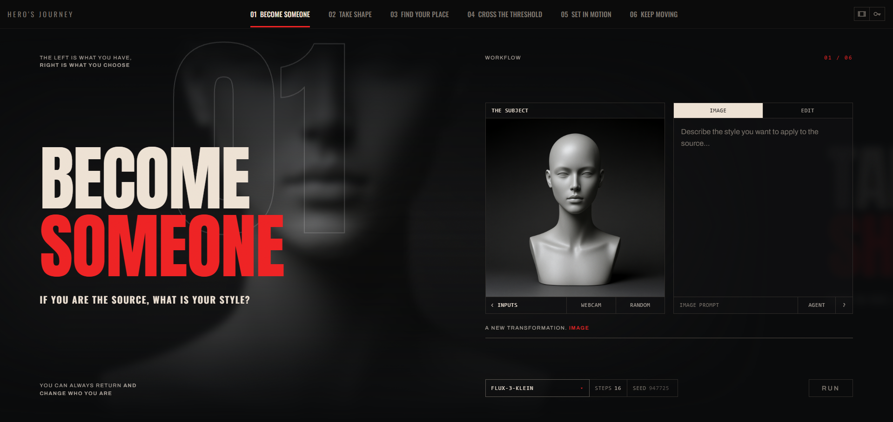
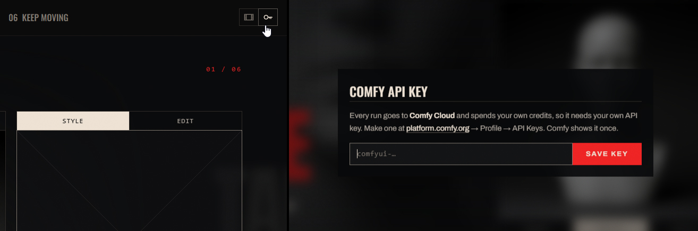

# Hero's Journey

Built for the [**Open Source Higgsfield Competition**](https://comfy.org/open-source-higgsfield), October 2026, by
[spiritform](https://github.com/spiritform). It runs locally with an API key on
[Comfy Cloud](https://platform.comfy.org).



**[Watch the demo video](https://www.youtube.com/watch?v=cau_e-NcMqo)**

<!-- screenshots go here -->

| | workflow | out |
| --- | --- | --- |
| 01 | **Become someone** | your character, from a photo of you and a style |
| 02 | **Take shape** | a character sheet — the bible every workflow after this reads a face off |
| 03 | **Find your place** | an image of your character in an environment |
| 04 | **Cross the threshold** | a board — one framing, or six |
| 05 | **Set in motion** | image to video — one shot, a board cut into a sequence, or first frame to last |
| 06 | **Keep moving** | motion transfer — reshoot it, swap who is in it, or change one thing |

## Install

You need **Node 22 or newer** and a Comfy Cloud account. **There is nothing to
install** — no dependencies, no build.

```
git clone https://github.com/spiritform/herosjourney
cd herosjourney
npm start
```

That serves <http://127.0.0.1:8800> and opens it. On Windows you can
double-click **`start.bat`** instead; on macOS and Linux, **`./start.sh`**.
Both check your node version and say if something is already on the port.

The server binds to `127.0.0.1` and nothing else. It is a local tool.

## Comfy API



Make one at [platform.comfy.org](https://platform.comfy.org/profile/api-keys) → Profile → API
Keys. Comfy shows it once.

If you would rather do it by hand, copy `.env.example` to `.env` and put the
key there, or set `COMFY_API_KEY` in your environment. **Runs spend your own
Comfy credits.**

## The Agent

**Every box you can write in has an agent behind it**, one press away in the
row under the box. It knows which workflow you are on and it can see what the
left slot is holding, so *what are you going for?* is a question about the
thing in front of you rather than in general.

It proposes a line and **nothing is sent until you take it.** The line lands in
the box, editable, and RUN is yours to press. The scaffolding that makes each
model behave lives on the server beside the graph it was written for and never
reaches the page — **who you become, what you wear, where you are and what
happens stay yours.**

It runs on Gemini through Comfy, so **a send spends credits**, which makes it
the one thing here that costs something on a keystroke rather than on RUN.

## What's next

**Every workflow ships with open weights on the picker.** Each one opens on the
model known to get the job right first time — `nano-banana-2.1` for the
pictures, `Seedance 2.5` for the two that move — because an app that fails while
somebody is watching argues nothing. **The open rows sit beside it**, one press
away, and every one of them has made a real file on Comfy Cloud's GPUs rather
than through a partner API: the weights are open, the machine is rented.

| | open rows |
| --- | --- |
| 01 | `qwen-image-edit-2.1`, `qwen-image-2.1-turbo`, `FLUX 3 Klein`, `MOSS-Image`, `Z-Image-Turbo`, `MOSS-Image T2I` |
| 02 03 04 | `qwen-image-edit-2.1`, `qwen-image-2.1-turbo`, `FLUX 3 Klein` |
| 05 | `MiniMax H3`, `Pika H3 Flex`, `LTX-2.5 I2V` |
| 06 | `Pika H3 Flex`, `LTX-2.3 Control`, `SCAIL-2 (MIT)` |

**06's three jobs each have one** — a reshoot, a swap and an edit — and
`LTX-2.3 Control` is the one that holds your framing frame by frame, because the
depth of your own clip drives it.

- **An open default**, workflow by workflow, once the open rows prove they hold
  a likeness as well — and **faster**, since the open video rows are minutes
  rather than seconds.
- **Extending a clip** came off the rail, because it is the one job with
  nothing open behind it. Every video extend worth the name is a partner API
  today, and the open ones expand the frame rather than the timeline — a
  different thing wearing a similar word. This one waits on weights.
- **Your own ComfyUI** instead of Comfy Cloud. The graphs in `graphs/` are
  ordinary API-format workflows and are the only thing that needs repointing.

## Keys on the page

`←` `→` travel · `1`–`6` jump to a section · `I` replay the opening

Everything you make is kept under `output/`, filed by sitting and by workflow, and
the journey survives a reload. `?session=new` in the URL starts a fresh one.

MIT licensed — see `LICENSE`.
