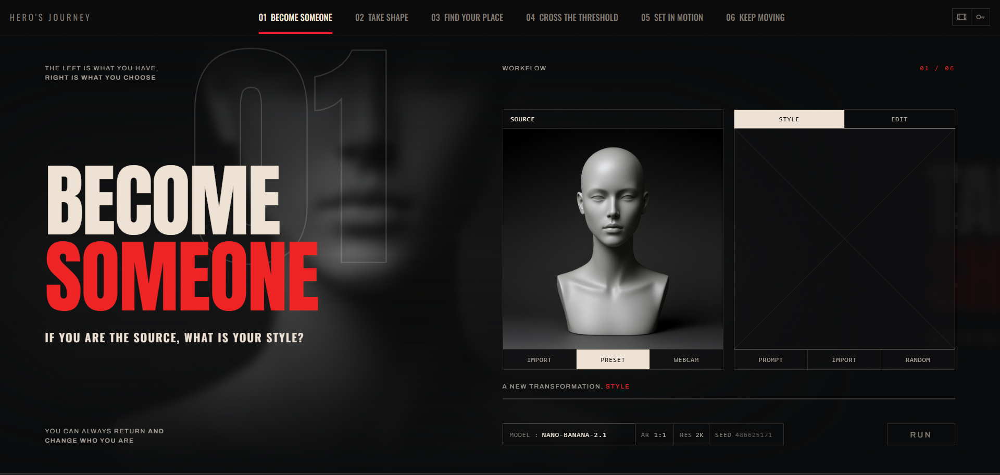
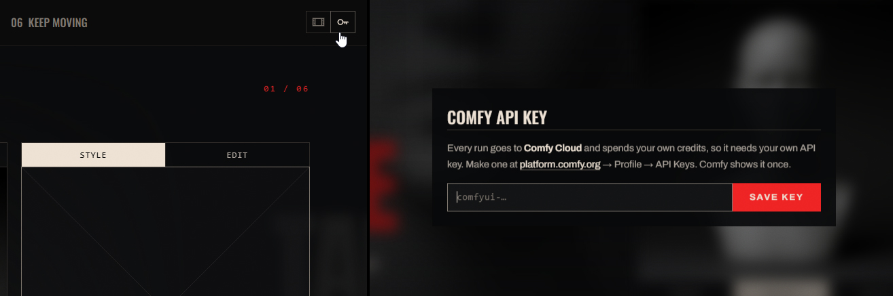

# Hero's Journey

Built for the **Open Source Higgsfield Competition**, October 2026, by
[spiritform](https://github.com/spiritform). It runs locally with an API key on
[Comfy Cloud](https://platform.comfy.org).



**[Watch the demo video](https://www.youtube.com/watch?v=w0SOO4E2NZs)**

<!-- screenshots go here -->

| | workflow | out |
| --- | --- | --- |
| 01 | **Become someone** | your character, from a photo of you and a style |
| 02 | **Take shape** | a character sheet — the bible every workflow after this reads a face off |
| 03 | **Find your place** | an image of your character in an environment |
| 04 | **Cross the threshold** | a board — one framing, or six |
| 05 | **Set in motion** | image to video |
| 06 | **Keep moving** | motion transfer — reshoot it, swap who is in it, change one thing, or carry it past the end |

## Install

You need **Node 22 or newer** and a Comfy Cloud account. **There is nothing to
install** — no dependencies, no build.

```
git clone https://github.com/spiritform/herosjourney
cd herosjourney
npm start
```

That serves <http://127.0.0.1:8800> and opens it. On Windows you can
double-click **`start.bat`** instead; on macOS and Linux, **`./start.sh`**.
Both check your node version and say if something is already on the port.

The server binds to `127.0.0.1` and nothing else. It is a local tool.

## Comfy API



Make one at [platform.comfy.org](https://platform.comfy.org/profile/api-keys) → Profile → API
Keys. Comfy shows it once.

If you would rather do it by hand, copy `.env.example` to `.env` and put the
key there, or set `COMFY_API_KEY` in your environment. **Runs spend your own
Comfy credits.**

## The Agent

**Every box you can write in has an agent behind it**, one press away in the
row under the box. It knows which workflow you are on and it can see what the
left slot is holding, so *what are you going for?* is a question about the
thing in front of you rather than in general.

It proposes a line and **nothing is sent until you take it.** The line lands in
the box, editable, and RUN is yours to press. The scaffolding that makes each
model behave lives on the server beside the graph it was written for and never
reaches the page — **who you become, what you wear, where you are and what
happens stay yours.**

It runs on Gemini through Comfy, so **a send spends credits**, which makes it
the one thing here that costs something on a keystroke rather than on RUN.

## What's next

**The partner models are here for the demo.** Every workflow ships on the model
known to get the job right first time — `nano-banana-2.1` for the pictures and
`Seedance 2.5` for the two that move — because an app that fails while somebody
is watching argues nothing. **Running all six on open weights is the next
step**, and most of it is already in this repo, one line in the slide table from
being back on the picker: `qwen-image-2.1-turbo`, `qwen-image-edit-2.1`,
`FLUX 3 Klein`, Microsoft's `Mage-Flow-Edit`, **MiniMax H3** and **SCAIL-2
(MIT)**. Each has made a real file on Comfy Cloud's GPUs rather than through a
partner API — the weights are open, the machine is rented — and one already
runs in the shipped build: 01's RANDOM, which is also what made the mannequin
bust.

- **06's `edit` and `extend` have no open row.** There is no open video extend
  model, and the open video edits today remove a named object rather than take
  an instruction. This one waits on weights.
- **An open default**, workflow by workflow, once the open rows prove they hold
  a likeness as well — and **faster**, since the open video rows are minutes
  rather than seconds.
- **Your own ComfyUI** instead of Comfy Cloud. The graphs in `graphs/` are
  ordinary API-format workflows and are the only thing that needs repointing.

## Keys on the page

`←` `→` travel · `1`–`6` jump to a section · `I` replay the opening

Everything you make is kept under `output/`, filed by sitting and by workflow, and
the journey survives a reload. `?session=new` in the URL starts a fresh one.

MIT licensed — see `LICENSE`.
